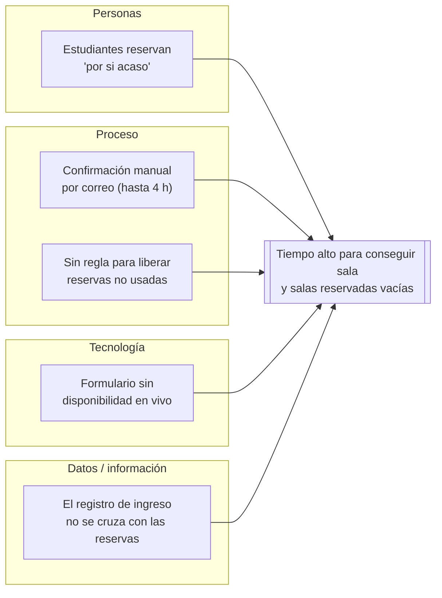
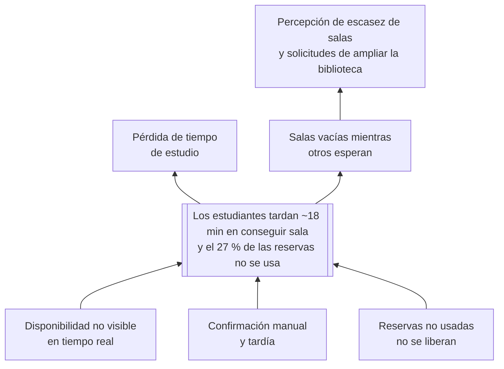

# F1 · Planteamiento del problema (ejemplo ficticio)

> [!example] Datos inventados para ilustrar. No los cites.

## 1. Idea inicial

> Hacer una app para reservar las salas de estudio de la biblioteca, porque hoy toca llenar un formulario y esperar que respondan el correo.

## 2. Diagrama de Ishikawa

| Causa | Categoría | Evidencia | ¿Hecho o hipótesis? |
|---|---|---|---|
| Confirmación manual por correo | Proceso | Procedimiento publicado por la biblioteca: respuesta "en un plazo de hasta 4 horas" | Hecho |
| Sin regla de liberación | Proceso | Entrevista con la coordinadora de la biblioteca | Hecho |
| Reservas "por si acaso" | Personas | 9 de 15 estudiantes entrevistados admiten reservar varias franjas | Hipótesis del equipo (muestra pequeña) |

## 3. Árbol de problemas

| Elemento | Descripción | Evidencia | ¿Hecho o hipótesis? |
|---|---|---|---|
| Problema central | 18 min en promedio para conseguir sala en hora pico; 27 % de reservas sin uso | Observación de 40 búsquedas de sala · registro de ingreso de un mes | Hecho (ficticio) |
| Causa 3 | Las reservas no usadas no se liberan | Reglamento de salas sin cláusula de liberación | Hecho |
| Efecto 2 | Salas vacías con estudiantes esperando | 6 observaciones en hora pico | Hecho |

## 4. Técnica libre · Es / No es

| | Es | No es |
|---|---|---|
| Quién | Estudiantes de pregrado y posgrado | Docentes (reservan por otro canal) |
| Dónde | Las 14 salas de la biblioteca central | Auditorios y aulas |
| Cuándo | Hora pico (10:00–16:00, semanas de parciales) | Vacaciones |

**Por qué esta técnica:** delimita el alcance y descarta los auditorios, que tienen otro proceso.

## 5. Problema reformulado

| Antes | Después |
|---|---|
| No existe un sistema para reservar salas en línea. | En la biblioteca central, los estudiantes tardan ~18 minutos en conseguir sala en hora pico, mientras el 27 % de las reservas confirmadas no se usa. |

**Pregunta preliminar:** ¿En qué medida mostrar la disponibilidad en tiempo real y liberar las reservas no usadas reduce el tiempo para conseguir sala?

> [!tip] Fíjate
> El "antes" contiene la solución ("sistema en línea"). El "después" describe algo que **se puede observar y medir hoy**, sin nombrar la solución.
