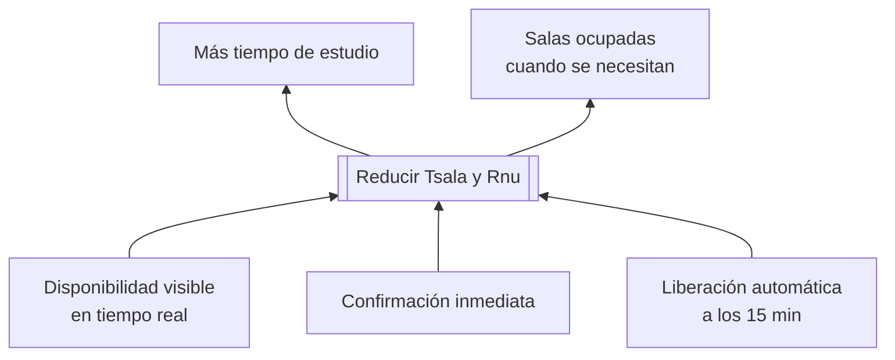

# F2 · Núcleo del proyecto (ejemplo ficticio)

> [!example] Datos inventados para ilustrar. Las piezas vigentes están en la *Cadena de coherencia* de [[02_Areas/Investigacion/Framework/Ejemplo-Reservas/00 Proyecto|00 Proyecto]].

## 1.2 Planteamiento del problema

**Problema en una frase:** En hora pico, los estudiantes de la biblioteca central tardan unos 18 minutos en conseguir una sala de estudio, mientras el 27 % de las reservas confirmadas queda sin usar.

**Causas que el proyecto interviene:** la disponibilidad no es visible en tiempo real · la confirmación es manual · las reservas no usadas no se liberan.

**Efectos que se espera que mejoren:** tiempo perdido buscando sala (directo) · salas vacías mientras otros esperan (directo) · percepción de escasez (indirecto).

**Delimitación:** 14 salas de la biblioteca central, estudiantes, hora pico de semestre. Quedan por fuera los auditorios, las reservas de docentes y la ampliación física de la biblioteca.

## 1.3 Pregunta de investigación

¿En qué medida un asistente de reservas con disponibilidad en tiempo real y liberación automática reduce el tiempo para conseguir sala y la proporción de reservas no usadas, frente al proceso actual?

## 1.5 Hipótesis

El asistente reduce en al menos **30 %** el tiempo para conseguir sala (**Tsala**) y reduce la tasa de reservas no usadas (**Rnu**) frente a la línea base.

## 1.6 Objetivos

**General:** Reducir el tiempo para conseguir sala y las reservas no usadas mediante un asistente de reservas con disponibilidad en tiempo real y liberación automática.

1. **Línea base:** medir Tsala y Rnu del proceso actual durante dos semanas de hora pico.
2. **Diseño:** definir las reglas de disponibilidad, confirmación de llegada y liberación.
3. **Construcción:** construir el asistente integrado al registro de ingreso.
4. **Evaluación:** comparar Tsala y Rnu con la línea base en un piloto de dos semanas.

### Árbol de objetivos

## Coherencia vertical

| Pieza | Prueba rápida | ✔ |
|---|---|---|
| Problema | Se observa hoy (18 min, 27 %) y no nombra la solución | ☑ |
| Pregunta | Pregunta "en qué medida", no "si se puede construir" | ☑ |
| Hipótesis | Nombra Tsala y Rnu y la dirección (reducir, ≥ 30 %) | ☑ |
| Objetivo general | Problema negado + medio (asistente) | ☑ |
| Específicos | Línea base → diseño → construcción → evaluación | ☑ |
