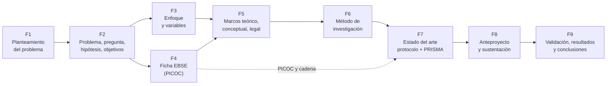

# Framework de investigación aplicada en ingeniería de software

> [!tip] ¿Primera vez aquí? Empieza por [[02_Areas/Investigacion/Framework/00 Empieza aqui|Empieza aquí]]: requisitos, qué hay en cada carpeta y cómo arrancar en 10 minutos.

Método paso a paso para llevar un trabajo de grado desde la idea hasta el anteproyecto y el informe final. Combina el **análisis del problema**, la **ingeniería de software basada en evidencia (EBSE)**, una **revisión sistemática con PRISMA 2020** y **design science** como método principal.

## El flujo

Cada fase **corrige la anterior**: la retroalimentación y los hallazgos (F3, F4, F7) pueden ajustar la pregunta, la hipótesis o los objetivos. Mantén la versión vigente en la tabla *Cadena de coherencia* de la nota del proyecto.

## Fases

| Fase | Qué produce | Guía | Plantilla(s) | Sección del informe |
|---|---|---|---|---|
| **F1** | Ishikawa, árbol de problemas, técnica libre y problema reformulado | [[G1 Tecnicas de planteamiento del problema\|G1]] | [[Plantillas/Investigacion/F1 Planteamiento del problema\|F1]] | Insumo de 1.2 |
| **F2** | Contexto, problema, pregunta, hipótesis, justificación y objetivos con coherencia vertical | [[G2 Problema pregunta hipotesis y objetivos\|G2]] | [[Plantillas/Investigacion/F2 Nucleo del proyecto\|F2]] | 1.1–1.6 |
| **F3** | Tabla de variables e instrumentos, enfoque elegido | [[G3 Enfoques de investigacion\|G3]] | [[Plantillas/Investigacion/F3 Enfoque y variables\|F3]] | Insumo de 2.2 y 3.3 |
| **F4** | PICOC, pregunta de evidencia, cadena, valoración crítica | [[G4 Ingenieria de software basada en evidencia\|G4]] | [[Plantillas/Investigacion/F4 Ficha EBSE\|F4]] | Insumo de 2.5 |
| **F5** | Marco teórico, conceptual (definición operacional) y legal | [[G5 Marco teorico conceptual y legal\|G5]] | [[Plantillas/Investigacion/F5 Marcos\|F5]] | 2.1–2.3 |
| **F6** | Método principal y componente de validación | [[G6 Metodos de investigacion empirica\|G6]] | [[Plantillas/Investigacion/F6 Metodo de investigacion\|F6]] | 3 |
| **F7** | Protocolo, registro de búsquedas, cribado, PRISMA, extracción, síntesis, matriz, brechas, antecedentes y declaración de IA | [[G7 Estado del arte con protocolo replicable\|G7]] | [[Plantillas/Investigacion/F7a Protocolo de revision\|F7a]] · [[Plantillas/Investigacion/F7b Registro de busquedas\|F7b]] · [[Plantillas/Investigacion/F7c Cribado y PRISMA\|F7c]] · [[Plantillas/Investigacion/F7d Sintesis y brechas\|F7d]] · [[Plantillas/Investigacion/F7e Antecedentes\|F7e]] · [[Plantillas/Investigacion/F7f Declaracion uso de IA\|F7f]] · [[Plantillas/Investigacion/Registro - articulo\|Registro]] | 2.4–2.5 y anexos |
| **F8** | Metodología de desarrollo, alcance, validación y sustentación | [[G8 Anteproyecto y sustentacion\|G8]] | [[Plantillas/Investigacion/F8 Anteproyecto\|F8]] | 3.1–3.3 |
| **F9** | Resultados, conclusiones y resumen | [[G9 Estructura del informe final\|G9]] | [[Plantillas/Investigacion/F9 Validacion y resultados\|F9]] | 4–5 |

## Cómo empezar un proyecto nuevo

1. Copia la carpeta [[02_Areas/Investigacion/Framework/Proyecto en blanco/00 Proyecto|Proyecto en blanco]] dentro de `01_Proyectos/` desde el explorador de archivos de tu sistema (Obsidian no duplica carpetas) y renómbrala, por ejemplo `01_Proyectos/Inv-NombreCorto/`. Ya trae todas las notas de las fases y la subcarpeta `Registros/`.
2. En `00 Proyecto`, llena las propiedades (título provisional, grupo, asesor, programa, inicio).
3. Lee la guía de cada fase **antes** de empezarla, llena su nota y repasa el checklist **"Antes de entregar"**.
4. Para el estado del arte, crea en `Registros/` una nota por cada documento encontrado (`S001 Apellido Año`) con la plantilla **Registro - articulo**.
5. Cada vez que cambie una pieza (problema, pregunta, hipótesis, objetivos), actualiza la **Cadena de coherencia** de `00 Proyecto` y anota el cambio en el *Registro de decisiones*.

Para ver un proyecto ya avanzado, abre el [[02_Areas/Investigacion/Framework/Ejemplo-Reservas/00 Proyecto|ejemplo ficticio de reservas de salas]] (F1, F2, F4 y F7c con 6 registros de muestra).

Si prefieres crear las notas una a una, las plantillas sueltas están en `Plantillas/Investigacion` (`Ctrl + P` → *Insertar plantilla*). Usa el mismo nombre de nota que tiene la plantilla y guárdalas todas en la carpeta del proyecto.

> [!tip] Las tablas automáticas
> Las notas `00 Proyecto`, `F7c`, `F7d` y `F7e` tienen tablas de **Bases** que leen las propiedades de las notas de **su misma carpeta** (y subcarpetas). Por eso cada proyecto debe tener su propia carpeta. Todos los proyectos aparecen en [[02_Areas/Investigacion/Framework/Vistas/Proyectos de investigacion.base|Proyectos de investigación]].

> [!info] Formatos en Word y Excel
> En `Framework/Adjuntos/` están los formatos para cuando una entrega se pide fuera de Obsidian: [[02_Areas/Investigacion/Framework/Adjuntos/Protocolo de revision.docx|protocolo de revisión]], [[02_Areas/Investigacion/Framework/Adjuntos/Bitacora revision de literatura.xlsx|bitácora de revisión]], [[02_Areas/Investigacion/Framework/Adjuntos/Diagrama PRISMA 2020.docx|diagrama PRISMA 2020]], [[02_Areas/Investigacion/Framework/Adjuntos/Lista de verificacion PRISMA 2020.docx|lista de verificación PRISMA 2020]] y [[02_Areas/Investigacion/Framework/Adjuntos/Declaracion de uso de IA.docx|declaración de uso de IA]]. Copia el archivo a la carpeta de tu proyecto antes de llenarlo.

## Material de apoyo

- [[02_Areas/Investigacion/Framework/Glosario|Glosario]]: términos del método.
- [[02_Areas/Investigacion/Framework/Cronograma orientativo|Cronograma orientativo]]: semanas por fase.
- [[02_Areas/Investigacion/Framework/Como adaptarlo|Cómo adaptarlo]]: rúbricas propias, trabajo individual, otro país u otra disciplina.
- [[02_Areas/Investigacion/Framework/Creditos y licencia|Créditos y licencia]].

## Reglas transversales

- **Evidencia antes que opinión.** Toda cifra o afirmación tiene fuente. Lo que es hipótesis del equipo se marca como tal.
- **Coherencia vertical.** El problema explica los objetivos, el estado del arte justifica la propuesta y la validación responde a la hipótesis.
- **El software es el medio, no el objetivo.** El objetivo es el cambio en el problema, medido con una variable y una línea base.
- **Replicabilidad.** Cadenas exactas, fechas, criterios y decisiones registradas: otro investigador debe poder repetir la revisión.
- **Integridad.** Toda fuente se verifica en el original antes de citarse. El uso de IA se declara.
- **Las correcciones se acogen o se justifican.** Ninguna observación de la retroalimentación se pierde (lista en `00 Proyecto`).

## Referencias base del método

Kitchenham, B. A., Dybå, T., & Jørgensen, M. (2004). Evidence-based software engineering. *ICSE 2004*, 273–281. · Kitchenham, B., & Charters, S. (2007). *Guidelines for performing systematic literature reviews in software engineering* (EBSE Technical Report 2007-01). · Page, M. J., et al. (2021). The PRISMA 2020 statement. *BMJ, 372*, n71. · Wieringa, R. J. (2014). *Design science methodology for information systems and software engineering*. Springer. · Hevner, A. R., March, S. T., Park, J., & Ram, S. (2004). Design science in information systems research. *MIS Quarterly, 28*(1), 75–105. · Wohlin, C., et al. (2024). *Experimentation in software engineering* (2.ª ed.). Springer. · Runeson, P., & Höst, M. (2009). Guidelines for conducting and reporting case study research in software engineering. *Empirical Software Engineering, 14*(2), 131–164.
