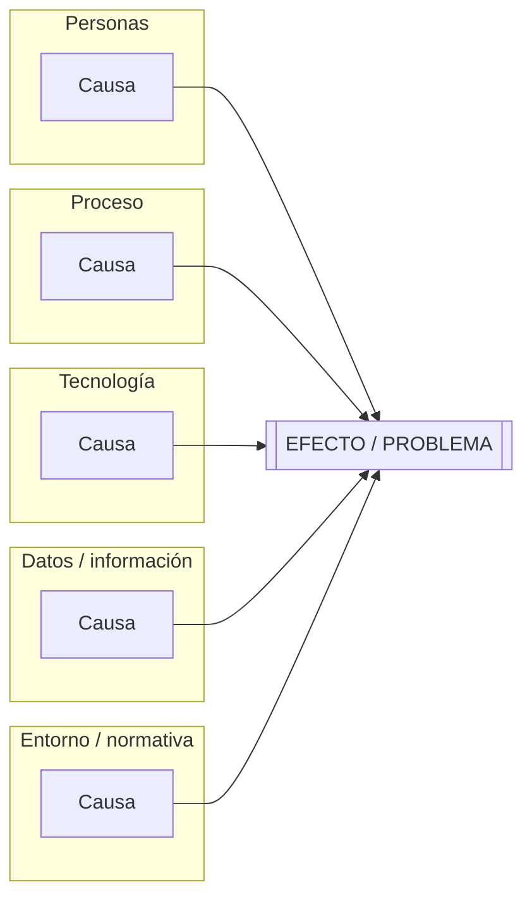
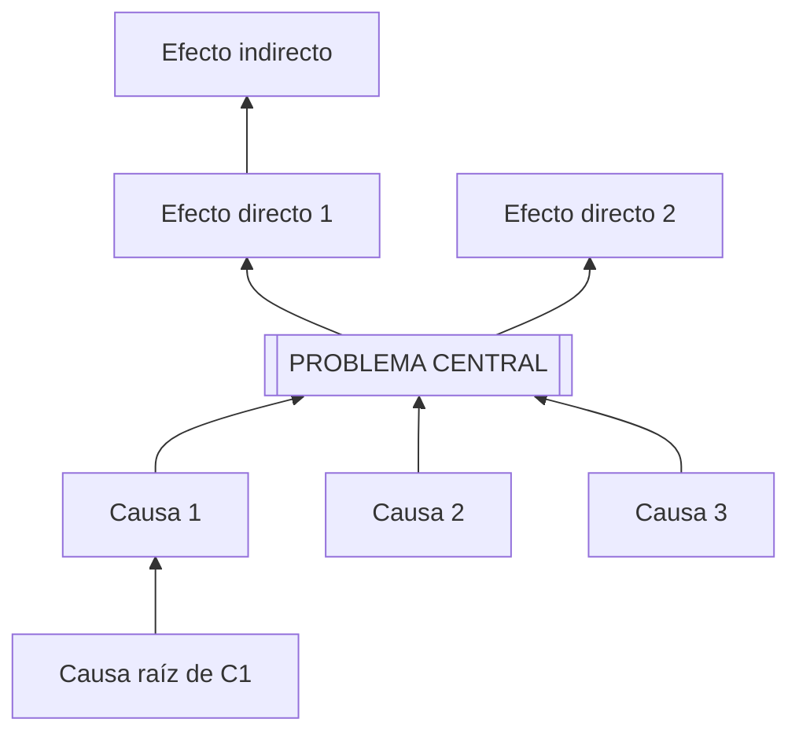

# F1 · Planteamiento del problema

> [!info] Objetivo de esta fase
> Pasar de una **idea** (intuición) a un **problema demostrado**: qué pasa, qué lo causa y qué consecuencias tiene, con evidencia. Se aplican tres técnicas que forman **un solo análisis** (no tres trabajos pegados).

## 1. Idea inicial

Enunciado tal como se presentó en el banco de ideas (3–4 líneas):

> 

## 2. Técnica 1 · Diagrama de Ishikawa (obligatoria)

Organiza las causas por categorías para no quedarse con la primera explicación. Cambia o elimina las categorías que no apliquen.

| Causa | Categoría | Evidencia (cifra, fuente, observación, testimonio) | ¿Hecho o hipótesis del grupo? |
|---|---|---|---|
|  |  |  |  |

## 3. Técnica 2 · Árbol de problemas (obligatoria)

Las **raíces** son las causas, el **tronco** es el problema central y las **ramas** son los efectos. Es la base del árbol de objetivos y de la justificación.

| Elemento | Descripción | Evidencia | ¿Hecho o hipótesis? |
|---|---|---|---|
| Problema central |  |  |  |
| Causa 1 |  |  |  |
| Causa 2 |  |  |  |
| Efecto 1 |  |  |  |
| Efecto 2 |  |  |  |

## 4. Técnica 3 · Técnica de libre elección

Debe **complementar** a las anteriores, no repetirlas. Opciones: 5 porqués (profundizar una rama) · mapa de empatía o de actores · DOFA del contexto · Pareto (si hay datos) · **Es / No es** (delimitar) · Problem Statement Canvas · árbol de objetivos.

**Técnica elegida y por qué:** 

**Fuente que la describe:** 

**Aplicación al proyecto:**

## 5. Problema reformulado

| Antes (idea inicial) | Después (tras las tres técnicas) |
|---|---|
|  |  |

**Delimitación**
- **Quiénes:** 
- **Dónde:** 
- **Alcance (qué incluye):** 
- **Qué queda por fuera:** 

**Pregunta de investigación preliminar:** ¿…?

## 6. Conclusiones del grupo

- Qué aprendimos de la idea: 
- Qué cambió: 
- Dudas abiertas: 

## Evidencia recolectada

Guarda fotos del tablero, borradores y fuentes: sirven de evidencia para el informe.

- 

## Antes de entregar

- [ ] Cada técnica tiene explicación (qué es, para qué sirve, cómo se construye, **cuándo conviene y sus limitaciones**).
- [ ] Cada técnica está aplicada de forma específica al proyecto, no genérica.
- [ ] Las causas y los efectos tienen evidencia, y lo que es hipótesis está marcado como tal.
- [ ] Las tres técnicas forman un solo análisis y no se contradicen.
- [ ] El problema reformulado mejora claramente el inicial y está delimitado (quiénes, dónde, alcance).
- [ ] La pregunta preliminar se deriva del análisis y es viable.
- [ ] Diapositivas: un diagrama por diapositiva, legible y con poco texto. Ensayado con cronómetro.
