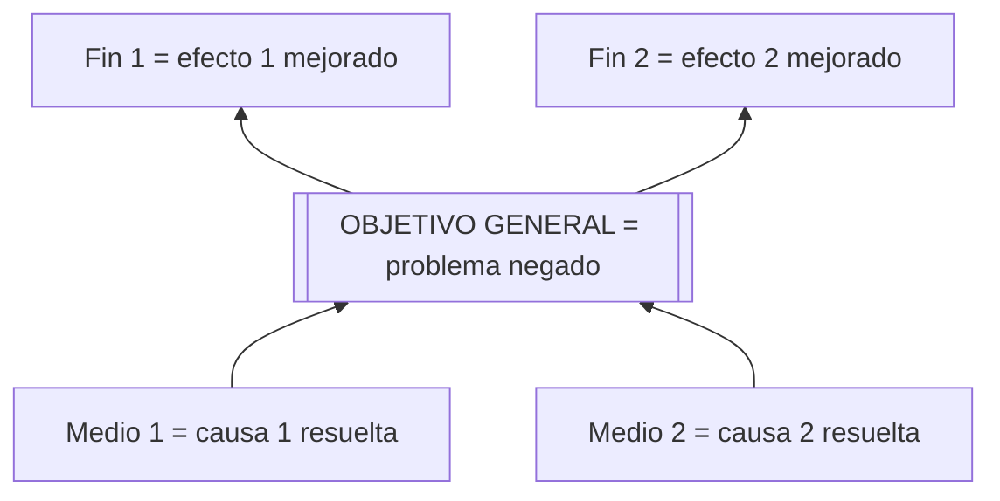

# F2 · Núcleo del proyecto: problema, pregunta, hipótesis, justificación y objetivos

> [!info] Objetivo de esta fase
> Escribir las piezas que sostienen todo el proyecto (sección **1. Introducción** del informe). Lo más importante no es cada pieza por separado, sino que **las cinco se sostengan entre sí** (coherencia vertical).

## Título provisional

Debe identificar el problema o la necesidad **y** el tipo de solución de software.

> 

## 1.1 Contextualización

Dónde ocurre el problema: sector, organización o población concreta, escala y actores. Si hay una organización real, nómbrala y describe cómo funciona hoy el proceso afectado.

## 1.2 Planteamiento del problema

> [!warning] Reglas del enunciado
> - Describe una **situación negativa que ocurre hoy y se puede observar**: qué pasa, a quién, dónde y qué pierde o arriesga.
> - **No** empieza con "dificultad para", "falta de", "ausencia de", "inexistencia de", "limitado" ni "problemas para".
> - **No** menciona la solución ni sus características.
> - Está **delimitado**: población, lugar u organización y alcance (qué queda por fuera).
> - Se apoya en **evidencia**. Lo que es hipótesis del grupo se indica como tal.
> - Separa el **problema central** de sus **causas** (lo que el proyecto interviene) y de sus **efectos** (lo que se espera que mejore).
>
> Prueba: "¿qué vería alguien que fuera a observarlo un día?". Si no hay escena, todavía no hay situación.

**Problema en una frase:** 

**Desarrollo:**

**Causas que el proyecto interviene:** 

**Efectos que se espera que mejoren:** 

**Delimitación y lo que queda por fuera:** 

## 1.3 Pregunta de investigación

Una sola pregunta, sobre lo que se quiere **saber**, no sobre lo que se va a construir. Relaciona la intervención con la variable del problema y admite respuesta de grado o de comparación ("¿en qué medida…?", "¿cómo se modifica… frente a…?").

> [!tip] Prueba
> Si se puede responder con "sí, se puede construir", todavía no es una pregunta de investigación.

¿…?

## 1.4 Justificación

Costo de que el problema siga ocurriendo (los efectos del árbol, con datos), a quién beneficia resolverlo y por qué una solución de ingeniería de software es pertinente frente a lo que existe hoy. Primera versión: de uno a tres párrafos; se amplía con el estado del arte.

## 1.5 Hipótesis

Respuesta tentativa a la pregunta, redactada como afirmación, que nombra la **variable medible** (tiempo, intentos, errores, contactos, cobertura…) y la **dirección** del cambio. Esa variable es la que se medirá en la validación.

> 

## 1.6 Objetivos

**Objetivo general.** Verbo en infinitivo. Es el **problema negado + el medio**, coherente con la pregunta y la hipótesis. No es "desarrollar un software": el software es el medio y el objetivo es el cambio en el problema.

> 

**Objetivos específicos** (entre 3 y 5, derivados de las causas que se intervienen). Deben cubrir la secuencia completa:

1. **Diagnosticar y medir la línea base:** 
2. **Definir o diseñar:** 
3. **Construir:** 
4. **Evaluar contra la línea base:** 

> [!tip] Escribe los objetivos específicos al final, cuando el problema y la pregunta estén estables. Si los escribes primero, saldrán del producto y no del problema.

### Árbol de objetivos (derivado del árbol de problemas)

## Coherencia vertical

| Pieza | Debe derivarse de… | Prueba rápida | ✔ |
|---|---|---|---|
| Problema | Árbol de problemas corregido | ¿Describe algo que pasa hoy y se puede observar o medir? | ☐ |
| Pregunta | Problema | ¿Pregunta por lo que no se sabe, no por lo que se va a construir? | ☐ |
| Hipótesis | Pregunta | ¿Nombra la variable medible y la dirección del cambio? | ☐ |
| Objetivo general | Problema negado + medio | ¿Se puede cumplir con lo que el proyecto va a construir? | ☐ |
| Objetivos específicos | Causas intervenidas | ¿Cubren diagnóstico, diseño, construcción y evaluación? | ☐ |

## Referencias usadas

Toda cifra o afirmación tomada de una fuente indica de dónde proviene, y toda fuente citada aparece en la lista.

- 

## Antes de entregar

- [ ] Problema: situación negativa, observable, delimitada, con evidencia y fuente, sin la solución dentro.
- [ ] Problema, causas y efectos claramente separados.
- [ ] La pregunta admite respuesta de grado o comparación y relaciona la intervención con la variable.
- [ ] La hipótesis es una afirmación con variable medible y dirección del cambio.
- [ ] La justificación tiene datos, beneficiarios concretos y pertinencia del software frente a lo existente.
- [ ] Objetivo general = problema negado + medio. Entre 3 y 5 específicos verificables (diagnóstico/línea base → diseño → construcción → evaluación).
- [ ] La tabla de coherencia vertical está completa.
- [ ] Plantilla del informe: portada, secciones y texto guía eliminado solo donde se desarrolló. Entre 3 y 6 páginas.
- [ ] Nombre del archivo: `NombreCorto_Avance1.docx`.
