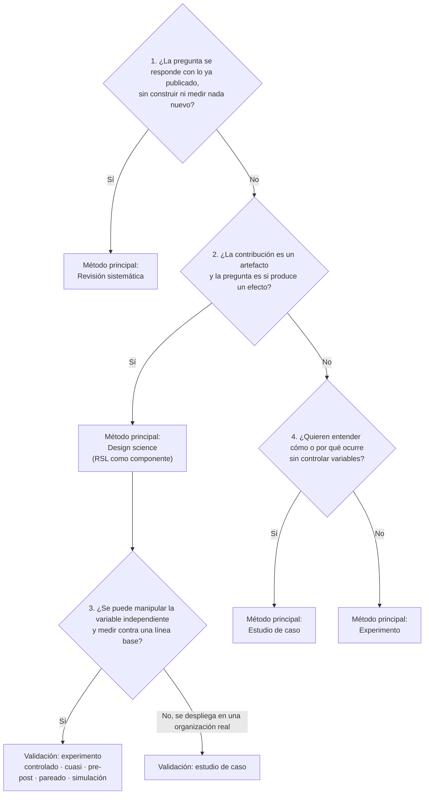

# F6 · Método de investigación

> [!info] Enfoque ≠ método
> El **enfoque** (F3) dice qué tipo de datos se recogen. El **método** dice cómo se organiza la investigación para responder la pregunta. Esta decisión define qué debe buscar el estado del arte (F7) y cómo se diseña la validación (F8).

## Cuatro preguntas, en orden

La primera respuesta afirmativa fija el método principal.

> [!tip] Criterio de cierre
> Si la hipótesis dice "el artefacto reduce o aumenta X en al menos Y %" → design science con validación **experimental**. Si dice "el artefacto mejora la práctica en la organización Z" → design science con validación por **estudio de caso**.

## Decisión del proyecto

| Elemento | Decisión | Justificación |
|---|---|---|
| Método principal |  |  |
| Componente de revisión | RSL con protocolo (F7) |  |
| Componente de validación (variante) |  |  |

## Ubicación del proyecto

| Pregunta | Respuesta |
|---|---|
| ¿Cuál es el artefacto? |  |
| ¿Qué efecto promete la hipótesis y sobre qué variable? |  |
| ¿Hay línea base? ¿Cómo se obtiene? |  |
| ¿Sujetos reales, escenarios simulados o datos sintéticos? |  |
| Principal amenaza a la validez y cómo se mitiga |  |
| ¿Qué debe buscar el estado del arte? (artefactos similares, cómo se evaluaron, variables, instrumentos) |  |

## Ciclo de design science (Wieringa, 2014)

| Momento | Dónde está en el trabajo de grado | Estado |
|---|---|---|
| Investigación del problema | F1, F2, F5 y F7 | ☐ |
| Diseño del tratamiento | Alcance (F8); ingeniería de requisitos y gestión del proyecto | ☐ |
| Validación del tratamiento | Diseño de la validación (F8); ejecución en la etapa de desarrollo (F9) | ☐ |
| Implementación del tratamiento | Fuera del alcance académico: trabajo futuro | — |

## Amenazas a la validez

| Tipo | Amenaza concreta | Mitigación |
|---|---|---|
| Conclusión |  |  |
| Interna (historia, maduración, aprendizaje de la tarea, novedad, instrumentación) |  |  |
| Constructo |  |  |
| Externa |  |  |

**Fuentes:** Wieringa (2014); Hevner et al. (2004); Peffers et al. (2007); Runeson y Höst (2009); Wohlin et al. (2024); Kitchenham y Charters (2007).
