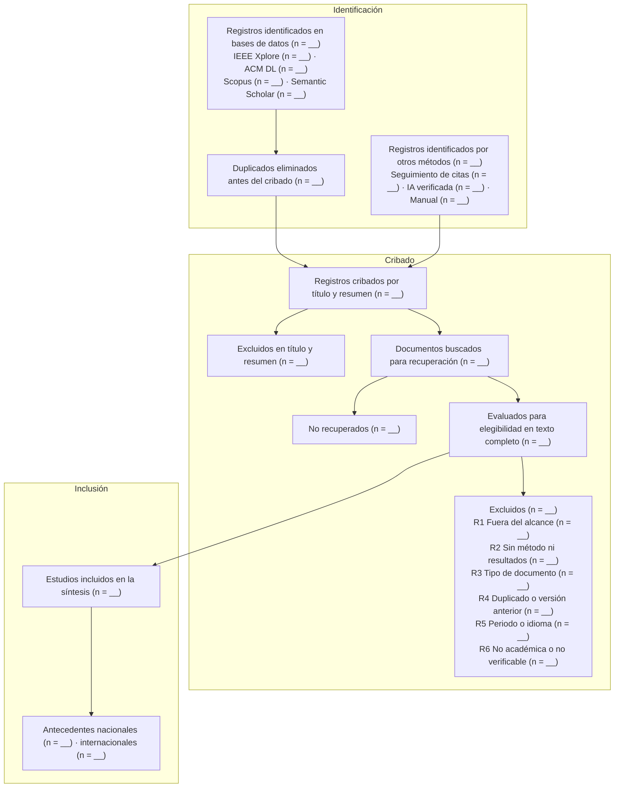

# F7c · Cribado y flujo PRISMA 2020

> [!info] Formato en Word o Excel: [[02_Areas/Investigacion/Framework/Adjuntos/Diagrama PRISMA 2020.docx|Diagrama PRISMA 2020 (.docx)]] · [[02_Areas/Investigacion/Framework/Adjuntos/Lista de verificacion PRISMA 2020.docx|Lista de verificación PRISMA 2020 (.docx)]] · [[02_Areas/Investigacion/Framework/Adjuntos/Bitacora revision de literatura.xlsx|Bitácora (.xlsx)]]

> [!info] Cómo funciona
> Cada registro identificado es una nota en `Registros/`, creada con la plantilla **Registro - articulo**. Las tablas de abajo se calculan solas a partir de sus propiedades y reemplazan las hojas *Cribado* y *PRISMA 2020* de la bitácora en Excel.
> **El número de resultados de cada vista (arriba de la tabla) es el número que va en el diagrama.** Cambia de vista con el selector de la esquina superior izquierda de la tabla.

## Tablero de cribado

```base
filters:
  and:
    - tipo == "registro-revision"
    - file.inFolder(this.file.folder)
views:
  - type: table
    name: "1 Identificados en bases"
    filters:
      and:
        - fuente == "Base de datos"
    groupBy:
      property: origen
      direction: ASC
    order:
      - file.name
      - origen
      - anio
      - titulo
      - duplicado
  - type: table
    name: "2 Identificados por otros métodos"
    filters:
      and:
        - fuente == "Otros métodos"
    order:
      - file.name
      - origen
      - anio
      - titulo
      - duplicado
  - type: table
    name: "3 Duplicados eliminados"
    filters:
      and:
        - duplicado == true
    order:
      - file.name
      - duplicado_de
      - origen
      - titulo
  - type: table
    name: "4 Cribados por título y resumen"
    filters:
      and:
        - duplicado != true
    groupBy:
      property: decision_tr
      direction: ASC
    order:
      - file.name
      - titulo
      - decision_tr_r1
      - decision_tr_r2
      - desacuerdo_resuelto_por
      - decision_tr
      - criterio_tr
  - type: table
    name: "5 Buscados para texto completo"
    filters:
      and:
        - duplicado != true
        - decision_tr == "Incluir"
    groupBy:
      property: decision_tc
      direction: ASC
    order:
      - file.name
      - titulo
      - decision_tc
      - razon_exclusion
      - verificado
  - type: table
    name: "6 Excluidos en texto completo"
    filters:
      and:
        - decision_tc == "Excluir"
    groupBy:
      property: razon_exclusion
      direction: ASC
    order:
      - file.name
      - autores
      - anio
      - titulo
      - razon_exclusion
  - type: table
    name: "7 Incluidos"
    filters:
      and:
        - decision_tc == "Incluir"
    order:
      - file.name
      - autores
      - anio
      - titulo
      - doi
      - verificado
      - fecha_verificacion
      - antecedente
  - type: table
    name: "⚠ Control: incluidos sin verificar (debe estar vacía)"
    filters:
      and:
        - decision_tc == "Incluir"
        - verificado != true
    order:
      - file.name
      - titulo
      - verificado
  - type: table
    name: "⚠ Control: excluidos sin razón (debe estar vacía)"
    filters:
      and:
        - decision_tc == "Excluir"
        - razon_exclusion.isEmpty()
    order:
      - file.name
      - titulo
      - razon_exclusion
  - type: table
    name: "⚠ Control: sin decisión de título y resumen"
    filters:
      and:
        - duplicado != true
        - decision_tr.isEmpty()
    order:
      - file.name
      - titulo
```

## Números del flujo

Copia aquí el número de cada vista y verifica la aritmética.

| Concepto | n | Vista |
|---|---|---|
| Registros identificados en bases de datos |  | 1 (desglose por base en los grupos) |
| Registros identificados por otros métodos |  | 2 |
| Duplicados eliminados antes del cribado |  | 3 |
| Registros cribados por título y resumen |  | 4 |
| Excluidos en título y resumen |  | 4 (grupo `Excluir`) |
| Buscados para recuperación (texto completo) |  | 5 |
| No recuperados |  | 5 (grupo `No recuperado`) |
| Evaluados en texto completo |  | 5 − no recuperados |
| Excluidos en texto completo (R1…R6) |  | 6 (desglose por razón en los grupos) |
| **Incluidos en la síntesis** |  | 7 |

### Controles de coherencia (todos deben dar 0)

- [ ] Total del registro de búsquedas (F7b) − identificados en bases = **0**
- [ ] (Identificados en bases + otros métodos − duplicados) − cribados = **0**
- [ ] Cribados − excluidos T/R − buscados = **0**
- [ ] Buscados − no recuperados − evaluados = **0**
- [ ] Evaluados − excluidos en texto completo − incluidos = **0**
- [ ] Excluidos en texto completo − (R1 + R2 + R3 + R4 + R5 + R6) = **0**
- [ ] Las tres vistas de control están vacías.

## Diagrama PRISMA 2020

Reemplaza cada `n = __` con los números de arriba y elimina las cajas que no apliquen.



> [!tip] Para el informe
> Dibuja la figura final con la plantilla oficial de prisma-statement.org usando estos mismos números. En el texto explica las razones de exclusión con sus cifras.

## Lista de excluidos en texto completo (anexo)

Usa la vista **6 Excluidos en texto completo** y cópiala al anexo del informe con su razón.

## Lista de verificación PRISMA 2020 (adaptada a ingeniería de software)

| # | Ítem | Dónde se reporta | ✔ |
|---|---|---|---|
| **A** | **Protocolo (2.5.a y anexo)** | | |
| 1 | Pregunta de revisión explícita, derivada del PICOC |  | ☐ |
| 2 | Criterios de inclusión y exclusión enumerados y justificados |  | ☐ |
| 3 | Fuentes de información y fecha de la última búsqueda |  | ☐ |
| 4 | Cadena completa por base, con filtros, tal como se ejecutó |  | ☐ |
| 5 | Procedimiento de selección: revisores, independencia, desacuerdos, herramientas |  | ☐ |
| 6 | Datos extraídos y cómo se extrajeron |  | ☐ |
| 7 | Protocolo escrito antes de la búsqueda y cambios registrados |  | ☐ |
| **B** | **Resultados de la búsqueda (2.5.b y anexo)** | | |
| 8 | Registro de búsquedas: fecha, base, cadena, número de resultados |  | ☐ |
| 9 | Diagrama PRISMA 2020 con todas las etapas |  | ☐ |
| 10 | Números coherentes entre etapas |  | ☐ |
| 11 | Otros métodos (citas, IA) en la rama derecha del diagrama |  | ☐ |
| 12 | Lista de excluidos en texto completo con su razón |  | ☐ |
| 13 | Tabla de extracción de los incluidos |  | ☐ |
| 14 | Todos los incluidos con DOI o URL verificada y su fecha |  | ☐ |
| **C** | **Síntesis (2.5.c)** — ver F7d | | |
| 15 | Estudios agrupados por temas, no uno por uno |  | ☐ |
| 16 | Coincidencias, diferencias y limitaciones |  | ☐ |
| 17 | Matriz comparativa con el proyecto como última fila |  | ☐ |
| 18 | Brechas explícitas, comprobables y conectadas con la pregunta y los objetivos |  | ☐ |
| 19 | Limitaciones de la revisión |  | ☐ |
| **D** | **Integridad y declaración de IA** — ver F7f | | |
| 20 | Declaración de uso de IA completa |  | ☐ |
| 21 | Ninguna referencia sale solo de la IA sin verificación |  | ☐ |
| 22 | Referencias APA 7 desde el gestor, completas y correspondientes |  | ☐ |

## Antes de entregar

- [ ] Registro de búsquedas (F7b) completo: base, fecha, cadena exacta, filtros y número de resultados.
- [ ] Diagrama PRISMA 2020 con números coherentes entre etapas (todos los controles de arriba en 0).
- [ ] Razones de exclusión en texto completo con su conteo (R1–R6).
- [ ] Lista de excluidos en texto completo, con su razón, en el anexo.
- [ ] Tabla de extracción con todos los campos para cada incluido (F7d).
- [ ] El 100 % de las fuentes son verificables (DOI o URL) y existen.
