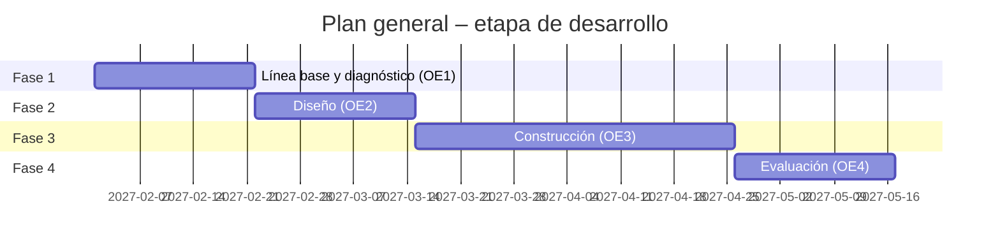

# F8 · Anteproyecto: metodología, alcance, validación y sustentación

> [!info] Objetivo de esta fase
> Cerrar el anteproyecto: consolidar en versión final todo lo anterior (es lo que más pesa) y escribir una primera versión del capítulo **3. Metodología**, entre 3 y 5 páginas. Es el punto de partida del plan de gestión del proyecto y de la etapa de construcción y validación.

## Correcciones del Avance 3

Especialmente las obligatorias: ejecución del cribado, lista de excluidos con su razón, aritmética de PRISMA, matriz comparativa completa, referencias corregidas en el gestor y declaración de IA completa y firmada.

| Observación | Qué se hizo | ¿Acogida? Si no, por qué |
|---|---|---|
|  |  |  |

## 3.1 Metodología de desarrollo del producto de software

Enfoque elegido: ☐ Scrum · ☐ Kanban · ☐ XP · ☐ Híbrido · ☐ Predictivo

Una elección razonada vale más que una descripción extensa. Explica **qué característica del proyecto y del equipo** la hace apropiada:

| Característica | Situación del proyecto | Implicación para el enfoque |
|---|---|---|
| Tamaño y disponibilidad del equipo |  |  |
| Estabilidad de los requisitos |  |  |
| Incertidumbre técnica |  |  |
| Participación del usuario / interesados |  |  |

**Roles e iteraciones** (descripción general; el detalle va en el plan de gestión del proyecto):

## 3.2 Alcance preliminar y plan general

**Qué se construirá en la etapa de desarrollo** (componentes y funcionalidades principales):
- 

**Qué queda por fuera:**
- 

**Cronograma general** (realista para el equipo en un semestre):

## 3.3 Estrategia de validación de la solución

Coherente con el método (F6: design science + componente de validación) y con las variables del marco conceptual (F5, 2.2.3).

> [!warning] La hipótesis manda sobre la validación
> Si promete una reducción de tiempo, debe haber una línea base medida o un plan concreto para medirla en la primera iteración.

**Diseño:** (pre-post, pareado, cuasiexperimento, simulación, estudio de caso)

**Sujetos o escenarios de prueba:**

### Matriz de indicadores

| Indicador | Definición operacional | Instrumento | Línea base (OE1) | Meta | Análisis |
|---|---|---|---|---|---|
|  |  |  |  |  |  |

**Análisis estadístico y prueba de hipótesis:**

**Amenazas a la validez y mitigación:** (ver F6)

## Insumos de otras asignaturas (anexos, sin nota)

No se produce nada nuevo: se reúne lo que exista, en el estado en que esté.

| Asignatura | Productos | Archivo / enlace | Para qué sirve después |
|---|---|---|---|
| Ingeniería de Requisitos | Elicitación, casos de uso, historias con criterios de aceptación, trazabilidad |  | Gestión de requisitos |
| Arquitectura de Software | Escenarios de calidad, modelo C4, ADR |  | Arquitectura |
| Construcción de Software | TDD/BDD, análisis estático, CI/CD, API |  | Producto y calidad del código |
| Patrones y Diseño (optativa) | Diseño y prototipo con patrones |  | Producto y arquitectura |
| Gestión de Datos (optativa) | Modelo y arquitectura de datos |  | Producto y calidad del código |

## Sustentación (15 min + 5 de preguntas)

Entre 10 y 12 diapositivas, poco texto, sin leer y con cámara encendida. **Lo que más pesa son las respuestas a las preguntas.**

| # | Bloque | Qué mostrar | Tiempo | Quién |
|---|---|---|---|---|
| 1 | Título, integrantes y asesor | Una diapositiva | 0,5 min |  |
| 2 | Problema | Contexto con datos, situación negativa, causas y efectos; pregunta e hipótesis | 2,5 min |  |
| 3 | Justificación y objetivos | Por qué importa y para quién; objetivo general y específicos | 1,5 min |  |
| 4 | Estado del arte | PRISMA en una diapositiva; matriz con el proyecto como última fila; brechas | 3,5 min |  |
| 5 | Metodología y alcance | Enfoque y por qué; qué se construye y qué no; cronograma | 2,5 min |  |
| 6 | Validación | Indicadores, línea base, metas y cómo se medirán | 2 min |  |
| 7 | Insumos de otras asignaturas | Lo más representativo de requisitos, arquitectura y construcción | 2,5 min |  |

**Preguntas probables y respuestas preparadas:**
- 

## Antes de entregar

- [ ] Problema, pregunta, hipótesis, justificación y objetivos coherentes entre sí (revisa la cadena de coherencia en la nota del proyecto).
- [ ] Todas las correcciones obligatorias del Avance 3 incorporadas o justificadas.
- [ ] Protocolo y PRISMA auditables; matriz completa; brechas conectadas con la pregunta y los objetivos.
- [ ] Validación: indicadores con línea base y meta, instrumentos, coherencia con la hipótesis y el método.
- [ ] Metodología de desarrollo justificada; roles e iteraciones.
- [ ] Alcance delimitado (qué sí y qué no) y cronograma coherente con los objetivos.
- [ ] Sin marcadores de plantilla en las secciones desarrolladas, sin comentarios abiertos.
- [ ] Figuras y tablas numeradas, referenciadas y explicadas; listas de tablas y figuras actualizadas.
- [ ] APA 7 desde el gestor; toda cita con su entrada y toda entrada citada.
- [ ] Anexos dentro del documento; acrónimos actualizados; declaración de IA actualizada y firmada.
- [ ] Archivos: `NombreCorto_Anteproyecto.docx` y `NombreCorto_Sustentacion.pptx`.
- [ ] Ensayado con cronómetro: 15 minutos para 7 bloques.
